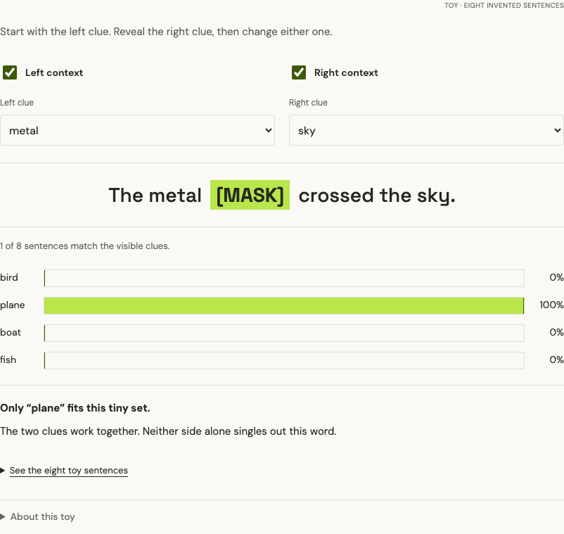

<div dir="rtl">

# LLM Lineage · حكاية النماذج اللغوية

[English](README.md) · [简体中文](README.zh-CN.md) · **العربية**

### كيف وصلنا من عدّ الحروف إلى نموذج نسولف معه؟

هنا تكتشف قصة النماذج اللغوية بتجارب تلعب فيها بنفسك. غيّر كلمة، خبّ معلومة، عط النموذج ذاكرة، وشف وش يتغيّر.

**٣٠ فصل تفاعلي · من ١٩١٣ إلى ٢٠٢٦ · تجارب صغيرة تشرح أفكار كبيرة**


كل اللي تحتاجه فضولك. كل فصل يعطيك فكرة، وشي تجرّبه بيدك، وسالفة تقدر بعدها تشرحها لخويك. مو لازم تكون دارس تعلّم آلة عشان تبدأ.

## كلمة وحدة تغيّر الإجابة

خلّ **metal (معدني)** مثل ما هي، وغيّر **sky (السماء)** إلى **lake (البحيرة)**. الحين وش الكلمة اللي تركب في الفراغ؟

| إذا كانت القرينة «السماء» | إذا صارت «البحيرة» |
| --- | --- |
|  |  |
| **plane (طائرة)** تركب. | الحين **boat (قارب)** هي اللي تركب. |

من هنا يبدأ فصل BERT: حتى الكلام اللي بعد الفراغ يساعدك تعرف الكلمة الناقصة. الصور من تجربة فيها ثمان جمل كتبناها للتوضيح، مو نموذج BERT فعلي. والنسب اللي تشوفها ناتجة عن عدّ الجمل المطابقة، مو احتمالات طلعها BERT.

## من وين تبدأ؟ خذ تجربة وشوف

| جرّب هالشي | وبعدها اسأل نفسك |
| --- | --- |
| **خمّن الحرف الجاي.** اطبع كم حرف، وبعدها طفّ الذاكرة. | إذا عدد حروف A وB متساوي، هل ترتيبها لازم يكون نفسه؟ |
| **حط الكلمات على خريطة.** حرّك كلمة «bank» من جهة النهر لجهة الفلوس. | وش صار للكلمات اللي حولها؟ |
| **افتح درج الذاكرة.** احفظ الرقم، خبّه، وبعدين بدّله. | إذا خبّيته، يعني نسيته؟ |
| **خلّ الكلمات تساعد بعض.** في تجربة Transformer، اخفِ الكلمات اللي لسه ما جاء دورها. | تقدر أول كلمة تطالع نهاية الجملة؟ |
| **علّم النموذج باختيارك.** اختر الإجابة الواضحة والمختصرة أكثر من مرة. | ممكن الإجابة تعجبك وهي أصلًا غلط؟ |
| **ركّب مساعد توصيل.** عطه المعلومات والخريطة ووقت يجرّب الطرق. | إذا الخريطة قديمة، تنفعه كثرة المحاولات؟ |

بتلقى في الصفحة الرئيسية ثلاث ألعاب خفيفة تبدأ فيها. ومن **Explore (استكشف)** تقدر تبحث في التجارب الثلاثين وتوصل للأوراق البحثية الأصلية.

<details>
<summary><strong>شف كيف تطلع على الجوال</strong></summary>

<br />


تقدر تستخدم اللمس أو الماوس أو الكيبورد. وإذا مفعّل تقليل الحركة في جهازك، الصفحة تراعي هالإعداد.

</details>

## جرّب أول، وتعمّق على راحتك

بداية كل فصل فيها مثال من الحياة، ومعه **Try this first (ابدأ بهالخطوة)**. توقّع النتيجة، غيّر شي، وبعدين افتح **What’s going on? (وش اللي قاعد يصير؟)** عشان تربط اللي شفته بالفكرة.

- **Play (جرّب):** تدخل على التجربة مباشرة.
- **Story (القصة):** تعرف وش كانت المشكلة، وش الفكرة اللي حلّتها، ووش صار ممكن بعدها. ومع الشرح رسمة وخلاصة تقدر تنقلها لغيرك.
- **Math & sources (الرياضيات والمصادر):** إذا ودّك تتعمّق، هنا المعادلات وبنية النموذج والنتائج والحدود والأبحاث الأصلية.

إذا تنقّلت بين هالأقسام، تجربتك تبقى مثل ما تركتها. وإذا متصفحك يدعم القراءة بصوت، تقدر تضغط **Listen to the idea (اسمع الفكرة)** وتسمع المقدمة القصيرة.

القصة تبدأ من عدّ الحروف، وتمرّ بالذاكرة وتمثيل الكلمات بالأرقام والانتباه وTransformer، لين توصل إلى ChatGPT والبحث عن المعلومات واستخدام الأدوات والاستدلال. كل فصل يمسك نقطة تحوّل، ومعها ورقة بحثية أساسية وقراءات إضافية.

**التجارب هنا صغيرة ومصمّمة عشان توضّح الفكرة.** بعضها يتعلّم من بيانات بسيطة، وبعضها يمشي على قواعد مكتوبة مسبقًا. تشتغل داخل متصفحك وتخلّيك تشوف آلية معيّنة قدامك، والفصل يشرح لك وش سوّى البحث الفعلي زيادة عليها.

## شغّله على جهازك

تحتاج <span dir="ltr">**Node.js 22.12+**</span> و<span dir="ltr">**npm 9.6.5+**</span>. افتح التيرمنال وشغّل الأوامر هذي:

</div>
<div dir="ltr">

```sh
git clone https://github.com/TheSyBuilder/how-llms-happened.git
cd how-llms-happened
npm install
npm run dev
```

</div>
<div dir="rtl">

بعدها افتح العنوان المحلي اللي يطلع لك في التيرمنال. الفصول الثلاثين جاهزة، لكن ما فيه نسخة منشورة على رابط عام للحين.

ملفات README الثلاثة تعرّفك على نفس المشروع بلغات مختلفة. الموقع والصور حاليًا بالإنجليزي.

<details>
<summary><strong>ودّك تساهم بالكود؟ ابدأ من هنا</strong></summary>

المشروع مبني بـ **Astro + Preact**، مع رسومات SVG وتجارب صغيرة تشتغل في المتصفح.

| وش تدور؟ | تلقاه هنا |
| --- | --- |
| ترتيب الفصول ومعلوماتها | <span dir="ltr">[`src/lib/chapters.ts`](src/lib/chapters.ts)</span> |
| المقدمات المبسّطة وأول خطوة في كل تجربة | <span dir="ltr">[`src/lib/first-steps.ts`](src/lib/first-steps.ts)</span> |
| القصص والتجارب التفاعلية | <span dir="ltr">[`src/components/`](src/components/)</span> |
| معلومات الأبحاث وروابطها | <span dir="ltr">[`data/corpus.json`](data/corpus.json)</span>، <span dir="ltr">[`src/lib/chapter-papers.ts`](src/lib/chapter-papers.ts)</span> |

<div dir="ltr">

```sh
npm run check
npm run build
npx playwright install chromium
npm run test:e2e
```

</div>

اختبارات المتصفح تغطّي الكمبيوتر والجوال بشاشة ضيّقة، والتعامل بالماوس واللمس والكيبورد، وتحويل الروابط القديمة وأخطاء الكونسول. وتحفظ صور للشاشات عشان نراجع شكل الصفحات.

</details>

## خلّ اللي بعدك يفهمها أسهل

فيه تجربة خلتك تقول «آها، الحين فهمت»؟ شاركها. وإذا ضعت في خطوة، [افتح issue](https://github.com/TheSyBuilder/how-llms-happened/issues) وقل لنا أي فصل، وش جرّبت، ووين الشرح ما كان واضح. عندك مثال أقرب أو تصحيح ومعه مصدر أصلي؟ نرحّب فيه.

وإذا أعجبك المشروع، عطه **Star** عشان يوصل لناس أكثر عندهم نفس الفضول.

</div>
