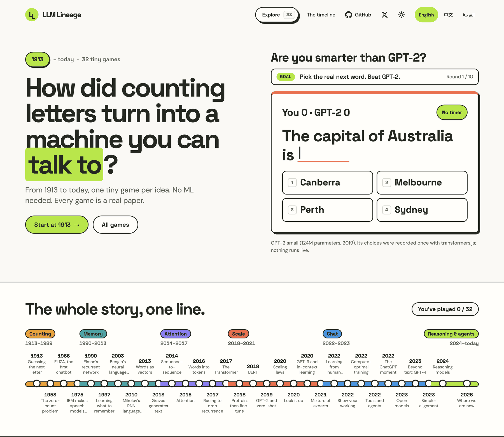
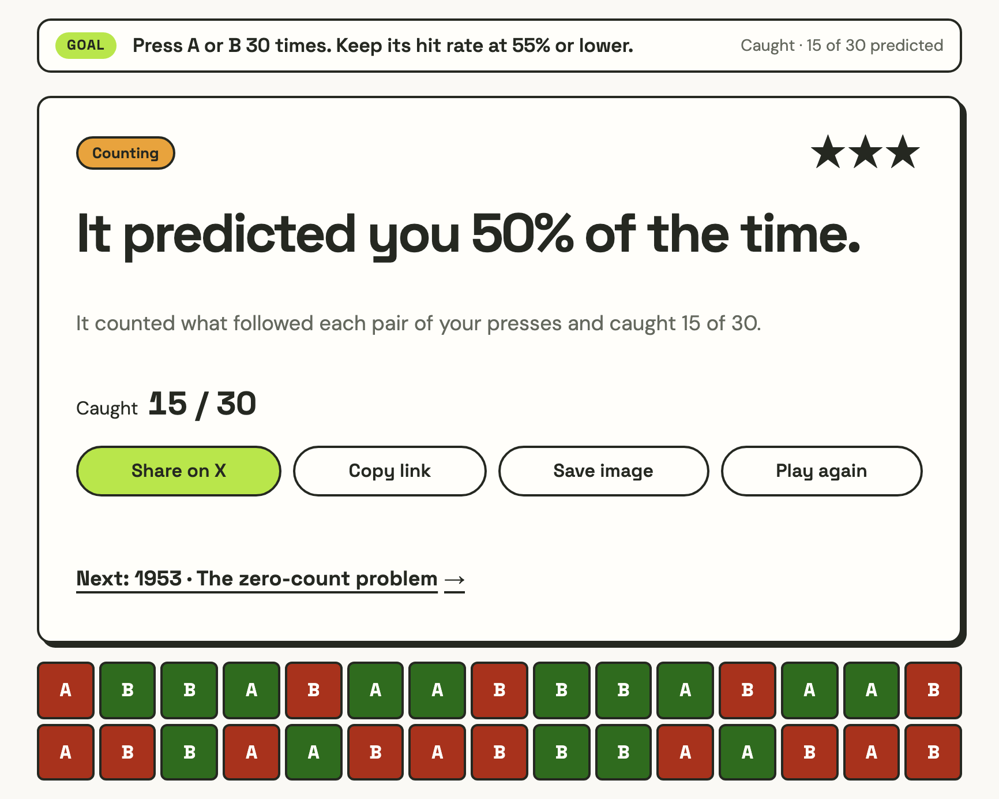
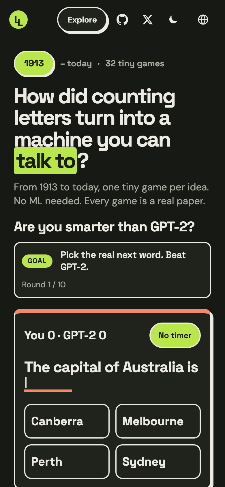

<div dir="rtl">

# كيف وصلنا للنماذج اللغوية الكبيرة

[English](README.md) · [简体中文](README.zh-CN.md) · **العربية**

**[العبها في المتصفح ←](https://thesybuilder.github.io/how-llms-happened/ar/)**

### كيف تحوّل عدّ الحروف إلى آلة تسولف معها؟

LLM Lineage يحكي تاريخ النماذج اللغوية الكبيرة في ٣٢ لعبة صغيرة تلعبها في المتصفح، من ماركوف وهو يعدّ حروف العلة في شعر بوشكين سنة ١٩١٣ إلى الوكلاء (agents) في ٢٠٢٦. كل لعبة مبنية على بحث حقيقي، ولها هدف، وفي آخرها تطلع لك نتيجة تقدر تشاركها.

**٣٢ لعبة · من ١٩١٣ إلى ٢٠٢٦ · ما تحتاج خلفية في تعلّم الآلة · English، 简体中文، العربية**



## ابدأ بتحدّي

أول ما تفتح الصفحة الرئيسية بتلقى **هل أنت أذكى من GPT-2؟** قدامك عشر جمل، وفي كل وحدة تختار الكلمة الجاية الحقيقية من أربع خيارات قبل ما يخلص الوقت. اختيارات GPT-2 small انسجلت مرة وحدة من النموذج الحقيقي اللي فيه ١٢٤ مليون معامل، يعني أنت تلعب ضد اللي اختاره فعلًا. ما فيه شيء يشتغل مباشرة.

بعدها اختر لعبة من الخط الزمني. هذي بعض الألعاب اللي نحبها:

| اللعبة | السنة | الفكرة اللي تعلّمك إياها |
| --- | --- | --- |
| **هل تستطيع أن تكون عشوائيًا؟** اضغط A أو B ثلاثين مرة، وحيلة عدّ من ١٩١٣ تحاول تتوقعك. | ١٩١٣ | سلاسل ماركوف |
| **اكسر إليزا.** اكشف أول روبوت محادثة بثلاث من علاماته. | ١٩٦٦ | مطابقة الأنماط وتأثير إليزا |
| **الكلمة الأقرب.** لغز يومي: دوّر على الكلمة السرية بمقياس القرب الحقيقي بين متجهات الكلمات. | ٢٠١٣ | تمثيل الكلمات بمتجهات (word embeddings) |
| **كم رمزًا يكلّف اسمك؟** اكتب أي شيء وشوف رموز GPT-2 الحقيقية تطلع قدامك. | ٢٠١٦ | ترميز أزواج البايتات (BPE) |
| **ألغاز الانتباه.** تحكّم في الكلمات اللي تنتبه لها كل كلمة، بأقل عدد حركات تقدر عليه. | ٢٠١٧ | Transformer |
| **درّب حَكَمًا.** علّم نموذج مكافأة، وبعدين شوفه يعطي كذبة قيلت بثقة نفس تقييم الحقيقة. | ٢٠٢٢ | التعلّم من تقييم البشر |
| **هل يعمل على حاسوبي المحمول؟** دوّر على أكبر نموذج مفتوح تكفيه ذاكرة جهازك. | ٢٠٢٣ | الأوزان المفتوحة والتكميم (quantization) |
| **اوصل إلى الهدف.** حل ألغاز أرقام، وبعدها شوف شجرة البحث اللي يمشي فيها نموذج التفكير. | ٢٠٢٤ | التفكير عن طريق البحث |

كل فصل يبدأ بلعبته. **القصة** تشرح لك المشكلة والفكرة ووش اللي غيّرته. و**التفاصيل والمصادر** فيها المعادلات وروابط الأبحاث الأصلية.



<details>
<summary><strong>قد إيش الألعاب دقيقة؟</strong></summary>

<br />

الألعاب نماذج تعليمية صغيرة، مسوّاة عشان تبيّن لك آلية وحدة بوضوح. أغلبها يتعلّم من بيانات قليلة مرة أو يمشي على قواعد مكتوبة باليد، وكل لعبة تقول هالشيء في سطر تحتها. وإذا استخدمت اللعبة بيانات من نموذج حقيقي، فالبيانات حقيقية فعلًا:

- **تحدّي GPT-2:** احتمالات الكلمة الجاية من GPT-2 small (١٢٤ مليون معامل)، انسجلت بـ transformers.js في ١١ نوفمبر ٢٠٢٦ (<span dir="ltr">[`scripts/record-gpt2.mjs`](scripts/record-gpt2.mjs)</span>).
- **الرموز:** مفردات GPT-2 وقواعد الدمج في BPE على مستوى البايت، وتأكدنا منها مقابل مُرمِّز مرجعي.
- **الكلمة الأقرب:** متجهات GloVe 6B بخمسين بُعد، مقصوصة لحوالي ٥٬٠٠٠ كلمة شائعة.
- **هل يعمل على حاسوبي المحمول؟:** عدد المعاملات مأخوذ من البطاقة الرسمية لكل نموذج.

</details>

## شغّله على جهازك

تحتاج <span dir="ltr">**Node.js 22.12+**</span> و<span dir="ltr">**npm 9.6.5+**</span>.

</div>
<div dir="ltr">

```sh
git clone https://github.com/TheSyBuilder/how-llms-happened.git
cd how-llms-happened
npm install
npm run dev
```

</div>
<div dir="rtl">

الموقع يشتغل بالوضع الفاتح والداكن، وعلى الجوالات من عرض ٣٢٠ بكسل، وباللمس أو الماوس أو الكيبورد. والصفحات العربية مرتبة من اليمين لليسار.

<details>
<summary><strong>على الجوال</strong></summary>

<br />


</details>

<details>
<summary><strong>ودّك تساهم؟ الكود والفحوصات</strong></summary>

المشروع مبني بـ **Astro + Preact**. التصميم وطريقة بناء الألعاب مكتوبة في <span dir="ltr">[`docs/launch-redesign.md`](docs/launch-redesign.md)</span>.

| وش تدوّر؟ | ابدأ من هنا |
| --- | --- |
| ترتيب الفصول وسنينها وحِقبها | <span dir="ltr">[`src/lib/chapter-meta.ts`](src/lib/chapter-meta.ts)</span>، <span dir="ltr">[`src/lib/chapters.ts`](src/lib/chapters.ts)</span> |
| أسماء الألعاب وأول خطوة فيها | <span dir="ltr">[`src/lib/first-steps.ts`](src/lib/first-steps.ts)</span> |
| شريط الهدف وبطاقة النتيجة والتقدّم المشتركة | <span dir="ltr">[`src/components/game/`](src/components/game/)</span>، <span dir="ltr">[`src/lib/progress.ts`](src/lib/progress.ts)</span> |
| الألعاب والقصص | <span dir="ltr">[`src/components/`](src/components/)</span> |
| معلومات الأبحاث وروابطها | <span dir="ltr">[`data/corpus.json`](data/corpus.json)</span>، <span dir="ltr">[`src/lib/chapter-papers.ts`](src/lib/chapter-papers.ts)</span> |
| الترجمات | <span dir="ltr">[`src/i18n/`](src/i18n/)</span> |

<div dir="ltr">

```sh
npm run check
npm run build
npx playwright install chromium
npm run test:e2e
```

</div>

أمر <span dir="ltr">`npm run build`</span> كمان يسوّي صورة مشاركة مقاسها ١٢٠٠ × ٦٣٠ لكل فصل (<span dir="ltr">`/og/<slug>.png`</span>)، ويفحص الروابط والمراسي (anchors) وحدود حجم كل صفحة.

</details>

## المصادر والحقوق

البيانات: أوزان GPT-2 وملفات المُرمِّز من OpenAI (رخصة MIT)؛ ومتجهات GloVe من Pennington وSocher وManning (رخصة Public Domain Dedication and License)؛ وقائمة كلمات ENABLE (ملكية عامة). الخطوط: Space Grotesk وDM Sans (رخصة SIL Open Font License). وكل فصل فيه روابط الأبحاث اللي انبنى عليها.

## ساعد اللي بعدك يفهم

لقيت لحظة خلّت فكرة تركب في راسك، أو لعبة لخبطتك؟ [افتح issue](https://github.com/TheSyBuilder/how-llms-happened/issues) واكتب أي فصل ووش جرّبت. والتصحيحات اللي معها مصادر أصلية مرحّب فيها.

وإذا استمتعت، عطه **Star** عشان يوصل لناس فضوليين مثلك.

</div>
