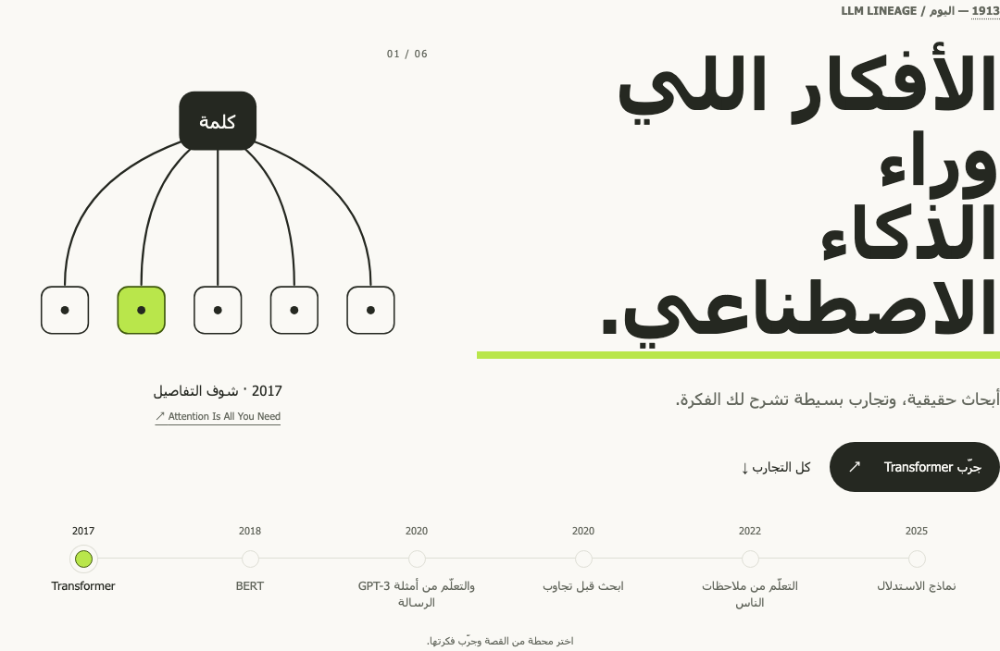
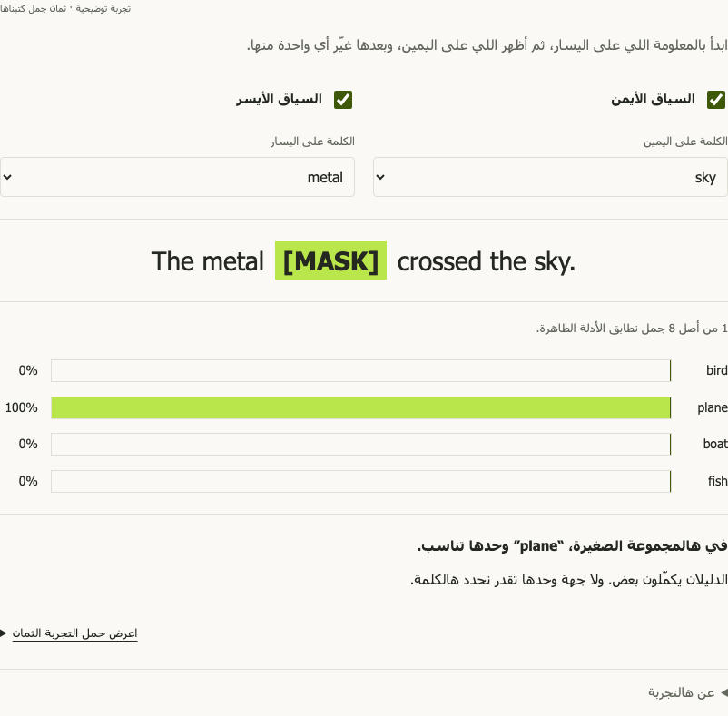
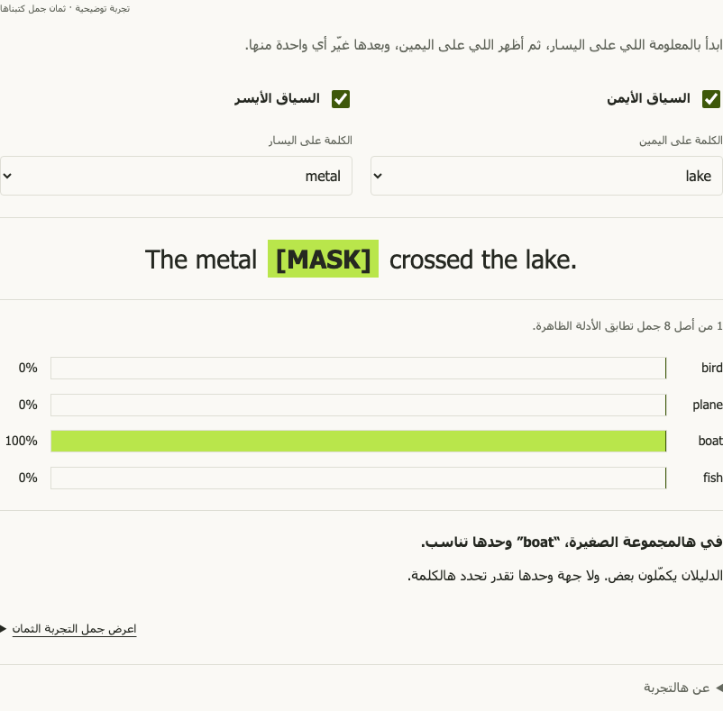
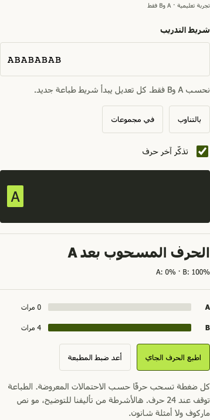

<div dir="rtl">

# LLM Lineage · حكاية النماذج اللغوية

[English](README.md) · [简体中文](README.zh-CN.md) · **العربية**

**[جرّب الموقع](https://thesybuilder.github.io/how-llms-happened/ar/)**

### كيف وصلنا من عدّ الحروف إلى نموذج نسولف معه؟

وش يصير لو النموذج نسي بداية الجملة؟ أو شاف كلمة كانت مخفية عنه؟ في هذا الموقع تجرّب بنفسك: تغيّر الكلمات أو الذاكرة وتشوف كيف تتغيّر النتيجة.

**٣٠ فصل تفاعلي · من ١٩١٣ إلى ٢٠٢٦ · جرّب الفكرة وشوف النتيجة**



كل فصل يشرح فكرة وحدة، ومعه تجربة بسيطة تساعدك تفهمها. الهدف إنك تطلع منه وأنت تقدر تشرحها لشخص ثاني بكلامك. وحتى لو أول مرة تقرأ عن النماذج اللغوية، تقدر تبدأ من هنا.

## كلمة وحدة تغيّر الإجابة

خلّ كلمة **metal (معدني)** مثل ما هي، وبدّل **sky (السماء)** بـ **lake (البحيرة)**. وش تتوقع يصير للكلمة الناقصة؟

| مع كلمة «السماء» | بعد ما نغيّرها إلى «البحيرة» |
| --- | --- |
|  |  |
| الجواب **plane (طائرة)**. | صار الجواب **boat (قارب)**. |

هذا مدخل فصل BERT: عشان تعرف الكلمة الناقصة، يفيدك تقرأ اللي قبلها واللي بعدها. التجربة في الصور تستخدم ثمان جمل كتبناها للتوضيح؛ ما تشغّل BERT نفسه. والنسب محسوبة من الجمل اللي تناسب اختياراتك في التجربة.

## محتار من وين تبدأ؟

| جرّب | وش تلاحظ؟ |
| --- | --- |
| **توقّع الحرف الجاي.** خلّ التجربة تطلع لك كم حرف، وبعدها عطّل خيار الذاكرة. | إذا عدد حروف A وB متساوي، هل لازم تجي بنفس الترتيب؟ |
| **شوف الكلمات على خريطة.** كلمة «bank» ممكن تعني بنك أو ضفة نهر. حرّكها من كلمات النهر لكلمات المال. | أي كلمات صارت أقرب لها؟ |
| **جرّب الذاكرة.** احتفظ بالرقم، اخفه من النتيجة، وبعدين بدّله. | الرقم اللي ما عاد يطلع لك، انمسح فعلًا؟ |
| **خلّ الكلمات تستفيد من بعض.** في تجربة Transformer، امنع كل كلمة من استخدام الكلمات اللي بعدها. | أول كلمة تقدر تستفيد من نهاية الجملة؟ |
| **علّم النموذج باختيارك.** اختر الإجابة الواضحة والمختصرة أكثر من مرة. | ممكن الإجابة تعجبك وهي أصلًا غلط؟ |
| **جهّز مساعد توصيل.** عطه المعلومات والخريطة ووقت يجرّب المسارات. | إذا الخريطة قديمة، تنفعه كثرة المحاولات؟ |

في الصفحة الرئيسية ثلاث تجارب سهلة تبدأ فيها. وإذا عندك موضوع معيّن في بالك، افتح **Explore** وابحث عنه؛ بتلقى التجربة ورابط البحث الأصلي.

<details>
<summary><strong>وهذا شكل التجربة على الجوال</strong></summary>

<br />


تقدر تجرّب باللمس أو الماوس أو الكيبورد. وإذا مفعّل خيار تقليل الحركة في جهازك، تقل حركة العناصر في الصفحة.

</details>

## جرّب أول، وتعمّق على راحتك

بتلقى في بداية كل فصل مثال بسيط، وتعليمات تحت **Try this first** تقول لك وش تجرّب. توقّع النتيجة قبل تغيّر أي شيء، وبعدها افتح **What’s going on?** واقرأ ليش طلعت لك هالنتيجة.

- **التجربة (Play):** جرّب وغيّر الإعدادات وشوف النتيجة.
- **القصة (Story):** وش كانت المشكلة؟ وكيف حاول الباحثون يحلّونها؟ بتلقى شرح ورسمة توضّح الفكرة.
- **التفاصيل والمصادر (Math & sources):** هنا المعادلات، وطريقة بناء النموذج، ونتائج البحث، والأشياء اللي ما قدر يحلّها، وروابط الأوراق الأصلية.

تنقّل بين الأقسام على راحتك؛ إعدادات التجربة تبقى مثل ما تركتها. وزر **Listen to the idea** يقرأ لك المقدمة إذا متصفحك يدعم هالميزة.

بتشوف كيف بدأت القصة بعدّ الحروف، وكيف دخلت الذاكرة وتمثيل الكلمات بالأرقام، وبعدها الانتباه وTransformer. ومن هناك نكمل إلى ChatGPT والبحث عن المعلومات واستخدام الأدوات وحل المسائل على خطوات. كل فصل يشرح فكرة غيّرت طريقة بناء النماذج أو استخدامها، ومعه البحث اللي قدّمها وأبحاث مرتبطة فيها.

**هذي تجارب تعليمية مبسّطة.** بعضها يتعلّم من أمثلة قليلة، وبعضها يشتغل بقواعد محددة. كلها تشتغل في المتصفح. وفي كل فصل نوضّح وش تمثّل التجربة، وش الفرق بينها وبين النموذج المستخدم في البحث.

## شغّله على جهازك

تحتاج <span dir="ltr">**Node.js 22.12+**</span> و<span dir="ltr">**npm 9.6.5+**</span>. افتح التيرمنال وشغّل الأوامر هذي:

</div>
<div dir="ltr">

```sh
git clone https://github.com/TheSyBuilder/how-llms-happened.git
cd how-llms-happened
npm install
npm run dev
```

</div>
<div dir="rtl">

بعدها افتح الرابط اللي يطلع لك في التيرمنال، وبيشتغل الموقع عندك على الجهاز. الفصول الثلاثين جاهزة، لكن الموقع ما نُشر على رابط عام للحين.

الموقع كامل متوفر **بالعربي والصيني والإنجليزي**، بكل فصوله الثلاثين وتجاربها. غيّر اللغة من الشريط اللي فوق وبتبقى في نفس الفصل. النسخة العربية بأسلوب سعودي خفيف، والصفحات مرتبة من اليمين لليسار. الصور هنا من النسخة العربية.

<details>
<summary><strong>ودّك تساهم بالكود؟ ابدأ من هنا</strong></summary>

المشروع مبني بـ **Astro + Preact**، مع رسومات SVG وتجارب صغيرة تشتغل في المتصفح.

| وش تبي تعدّل؟ | الملف أو المجلد |
| --- | --- |
| ترتيب الفصول ومعلوماتها | <span dir="ltr">[`src/lib/chapters.ts`](src/lib/chapters.ts)</span> |
| المقدمات المبسّطة وأول خطوة في كل تجربة | <span dir="ltr">[`src/lib/first-steps.ts`](src/lib/first-steps.ts)</span> |
| القصص والتجارب التفاعلية | <span dir="ltr">[`src/components/`](src/components/)</span> |
| معلومات الأبحاث وروابطها | <span dir="ltr">[`data/corpus.json`](data/corpus.json)</span>، <span dir="ltr">[`src/lib/chapter-papers.ts`](src/lib/chapter-papers.ts)</span> |

<div dir="ltr">

```sh
npm run check
npm run build
npx playwright install chromium
npm run test:e2e
```

</div>

الاختبارات تتأكد إن الصفحات تشتغل على الكمبيوتر وشاشات الجوال الصغيرة، وإنك تقدر تستخدم الماوس واللمس والكيبورد. وتفحص الروابط القديمة وأخطاء الكونسول، وتحفظ لقطات شاشة نراجع فيها شكل الصفحات.

</details>

## فيه شيء ما وضح؟ قل لنا

إذا تجربة ساعدتك تفهم فكرة، شاركها مع غيرك. وإذا وقفت عند شيء مو واضح، [افتح issue](https://github.com/TheSyBuilder/how-llms-happened/issues) وقل لنا أي فصل ووش جرّبت ووين علقت. وعندك مثال أوضح أو معلومة تحتاج تصحيح؟ أرسلها، ومع التصحيح حط رابط المصدر الأصلي.

وإذا أعجبك المشروع، عطه **Star** عشان يوصل لناس أكثر.

</div>
