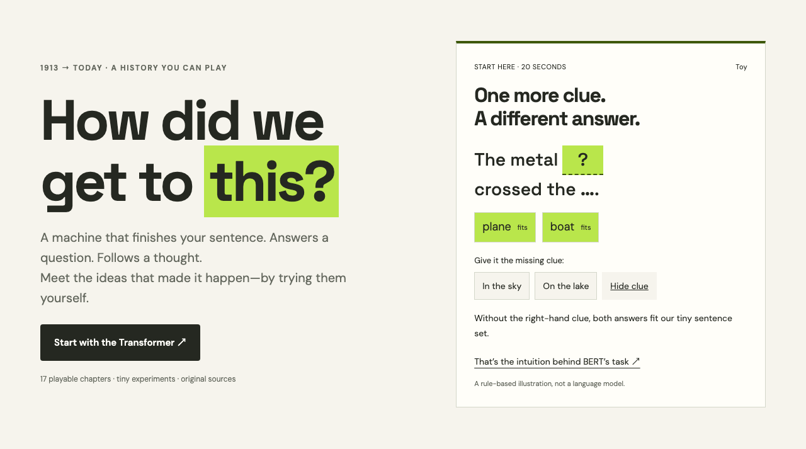

# LLM Lineage

**How did counting letters turn into a machine you can talk to?**

An interactive history of language models. Change the input, watch the mechanism, and leave with an idea you can explain to a friend.



## A few things to try

- **BERT:** reveal the clue after a missing word. Watch two possible answers become one.
- **Pretraining:** teach two review labels, then try a word that has never had a label. See what prior reading transfers.
- **Human feedback:** teach a preference for clear, short answers. Discover why a confidently wrong answer can earn the same score.
- **Mixture of experts:** crowd one expert while others have room. Find out why spare capacity is not enough.
- **Reasoning:** spend another attempt on a puzzle. Discover both the benefit and the limit of extra computation.

There are **17 implemented chapters** across a timeline of 30 turning points: Transformer, pretraining, BERT, GPT-2, scaling laws, GPT-3, retrieval, human feedback, ChatGPT, GPT-4, Chinchilla, open models, mixture of experts, tools, DPO, chain-of-thought, and reasoning models. Remaining chapters are marked coming soon.

## Run it

```sh
npm install
npm run dev
```

Open the local address printed by Astro. This repository contains the site source; a public hosted version has not yet been configured.

Each chapter has a small browser experiment, an invitation to investigate, and a takeaway. The math, architecture details, results, limitations and primary sources sit in collapsed sections. Toys are labeled illustrations: some use tiny learned models, others use explicit rules. They do not run the large models described by the papers.

## Make it better

If an experiment made an idea click, a star helps others find the project. If it did not, [open an issue](https://github.com/TheSyBuilder/how-llms-happened/issues) with the chapter, what you tried, and where the explanation lost you. Corrections with primary sources and clearer teaching examples are welcome.

Built with Astro and Preact. Chapter metadata is in `src/lib/chapters.ts`; paper facts and links come from `data/corpus.json` and `src/lib/chapter-papers.ts`.

## Check

```sh
npm run check
npm run build
npx playwright install chromium
npm run test:e2e
```

The browser suite exercises mouse, touch and keyboard controls at desktop and narrow phone widths, checks redirects and console errors, and saves screenshots for visual review. Respect for reduced motion and accessible native controls are part of the experiments.
