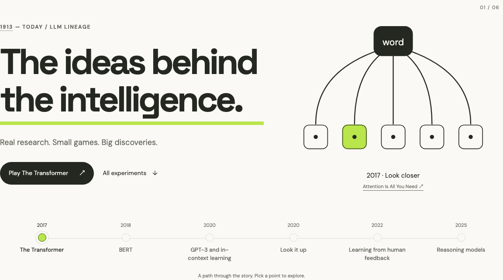
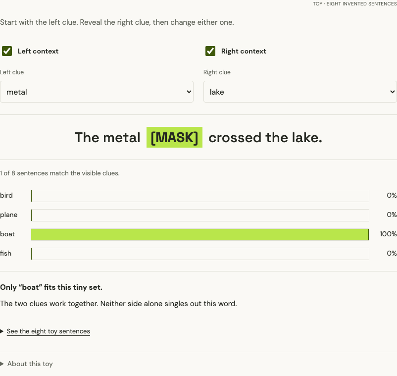
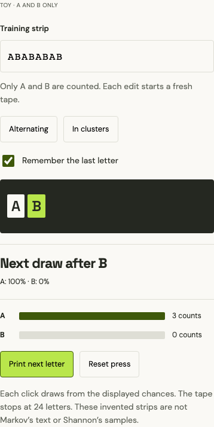

# LLM Lineage

**English** · [简体中文](README.zh-CN.md) · [العربية](README.ar.md)

**[Play LLM Lineage](https://thesybuilder.github.io/how-llms-happened/)**

### How did counting letters turn into a machine you can talk to?

LLM Lineage is an interactive history of the ideas that made large language models possible. Follow 30 turning points from Markov's letter counts in 1913 to modern systems that hold conversations, use tools and work through problems.

Every chapter gives you an idea to play with. Change a word to see how context changes a prediction. Decide what a network remembers. Spend a training budget and discover why bigger doesn't always mean better. Small experiments run right in your browser, alongside visual explanations and the original research.

**30 playable chapters · 1913–2026 · Tiny experiments, real ideas**



No machine-learning background needed. Start with a question that interests you, try the experiment, and leave with an idea you can explain to a friend. The equations and research details are there whenever you want to go further.

## One word changes everything

Keep **metal**. Change **sky** to **lake**. Which word belongs in the gap now?

| A clue from the sky | A clue from the lake |
| --- | --- |
|  |  |
| **plane** fits. | Now **boat** fits. |

That is the starting idea behind the BERT chapter: words after a gap can help, too. These screenshots show an illustration with eight invented sentences, not a running BERT model. The percentages count matches in that tiny set.

## Pick your first “oh, I get it”

| Try this | Then ask yourself |
| --- | --- |
| **Guess the next letter.** Print a few letters, then switch memory off. | Do the same numbers of A and B always make the same pattern? |
| **Give words a map.** Move “bank” from river words toward money words. | Which neighbours change? |
| **Open the memory drawer.** Protect, hide and replace a stored number. | Is hiding the same as forgetting? |
| **Let words share clues.** In the Transformer toy, hide future words. | Can the first word peek at the ending? |
| **Teach by choosing.** Prefer the short, clear answer. | Can an answer sound helpful and still be wrong? |
| **Build a delivery helper.** Give it notes, a map and time to try routes. | Can more trying fix an old map? |

The home page suggests three gentle starting games. **Explore** lets you search all 30 experiments and find their original papers.

<details>
<summary><strong>Take a peek on a phone</strong></summary>

<br />


The controls work with touch, a mouse or a keyboard. Motion respects your reduced-motion setting.

</details>

## Play first. Go deeper when you want.

Every chapter starts with an everyday explanation and a **Try this first** prompt. Make a guess, change something, then open **What’s going on?** to connect the result to the idea.

- **Play** puts the experiment in front of you.
- **Story** explains the problem, the breakthrough and what it made possible, with a diagram and a takeaway.
- **Math & sources** opens the equations, architecture, results, limitations and original research.

Switching views keeps your experiment's state. Short introductions also have a **Listen to the idea** button when your browser supports reading aloud.

The story runs from early letter counts through memory, word vectors, attention and the Transformer, then on to ChatGPT, retrieval, tools and reasoning. Each chapter is a turning point, with an anchor paper and related reading.

**The experiments are small teaching toys.** Some learn from tiny datasets; others use hand-written rules. They run in your browser and make one mechanism visible. The chapter explains how the real research goes further.

## Run it on your computer

You need **Node.js 22.12+** and **npm 9.6.5+**. Clone the repository, then run:

```sh
git clone https://github.com/TheSyBuilder/how-llms-happened.git
cd how-llms-happened
npm install
npm run dev
```

Open the local address printed in the terminal, or [explore all 30 chapters online](https://thesybuilder.github.io/how-llms-happened/).

The whole website is available in **English, 简体中文 and العربية**. Switch languages in the top bar; your chapter stays open. Chinese uses everyday explanations, and Arabic uses a conversational Saudi voice with right-to-left layouts. The screenshots below show the English edition.

<details>
<summary><strong>For contributors: code and checks</strong></summary>

Built with **Astro + Preact**, with SVG diagrams and small browser experiments.

| Looking for… | Start here |
| --- | --- |
| Chapter order and metadata | [`src/lib/chapters.ts`](src/lib/chapters.ts) |
| Everyday introductions and first actions | [`src/lib/first-steps.ts`](src/lib/first-steps.ts) |
| Stories and interactive toys | [`src/components/`](src/components/) |
| Paper facts and links | [`data/corpus.json`](data/corpus.json), [`src/lib/chapter-papers.ts`](src/lib/chapter-papers.ts) |

```sh
npm run check
npm run build
npx playwright install chromium
npm run test:e2e
```

The browser checks cover desktop and narrow phone layouts, mouse/touch/keyboard interactions, redirects and console errors. They also save screenshots for visual review.

</details>

## Help the next person understand

Found a moment that made the idea click? Share it. Got stuck? [Open an issue](https://github.com/TheSyBuilder/how-llms-happened/issues) with the chapter, what you tried and where we lost you. Clearer examples and corrections backed by original sources are welcome.

If you enjoyed the playground, a **star** helps other curious people find it.
