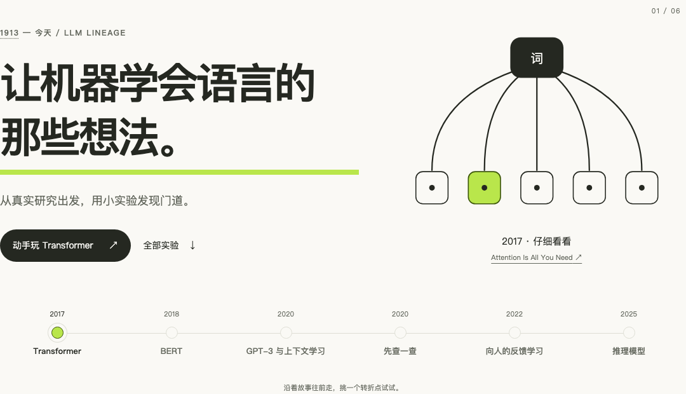
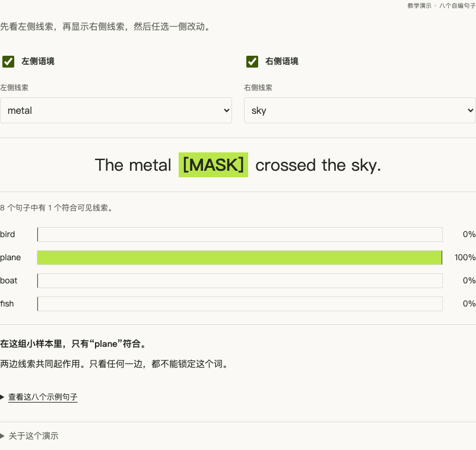
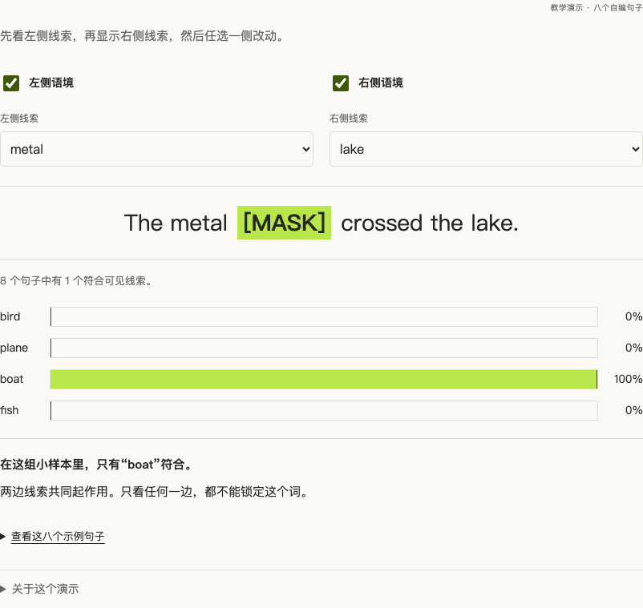
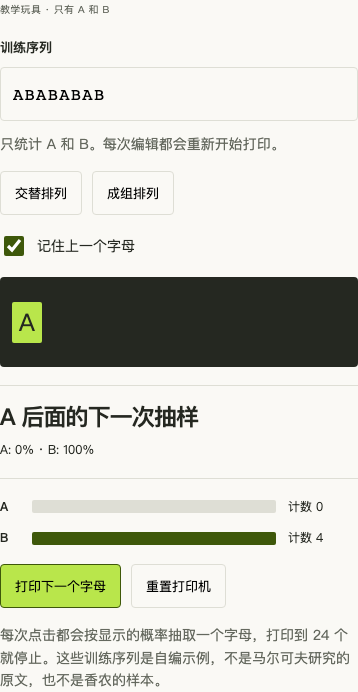

# LLM Lineage · 大语言模型是怎么走到今天的？

[English](README.md) · **简体中文** · [العربية](README.ar.md)

### 从数一数字母，到能和人聊天，中间发生了什么？

这是一部可以动手玩的语言模型发展史。换个词，藏起一条线索，给模型一点记忆，看看结果会怎么变。

**30 个可玩的章节 · 1913—2026 · 用小实验，弄懂大想法**



带着好奇心来就行。每章讲清一个想法，让你亲手做个小实验，最后能用自己的话讲给朋友听。没学过机器学习，也可以从这里开始。

## 只换一个词，答案就变了

保留 **metal（金属的）**，把 **sky（天空）** 换成 **lake（湖泊）**。这次，空白处该填什么？

| 线索是「天空」 | 线索变成「湖泊」 |
| --- | --- |
|  |  |
| **plane（飞机）** 符合线索。 | 现在是 **boat（船）**。 |

BERT 这一章就从这里讲起：猜一个缺失的词，后面的文字也能帮忙。图里是用八个自编句子做的小演示，并没有运行真正的 BERT；这里的百分比来自句子计数，不是 BERT 的预测概率。

## 先挑一个，让你「原来如此」的小实验

| 动手试试 | 再想一想 |
| --- | --- |
| **猜下一个字母。** 打印几个字母，再关掉记忆。 | A 和 B 的数量一样，排列规律就一定一样吗？ |
| **给词语画张地图。** 把「bank」从河流相关的词旁边，移到金融相关的词旁边。 | 它的邻居变了吗？ |
| **打开记忆抽屉。** 保留、隐藏，再替换里面的数字。 | 藏起来，和忘掉，是一回事吗？ |
| **让词语互相找线索。** 在 Transformer 实验里，遮住后面的词。 | 第一个词还能偷看结尾吗？ |
| **用选择来教模型。** 多选几次简短、清楚的回答。 | 听着有道理，就一定说对了吗？ |
| **组装一个配送小助手。** 给它信息、地图和尝试路线的时间。 | 地图过时了，多试几次就有用吗？ |

首页推荐了三个容易上手的小游戏。打开 **Explore（探索）**，还能搜索全部 30 个实验，找到对应的原始论文。

<details>
<summary><strong>看看手机上的样子</strong></summary>

<br />


触屏、鼠标、键盘都能操作。如果你开启了系统的「减少动态效果」，页面也会相应减少动画。

</details>

## 先玩起来，想深究时再往下看

每章先用日常例子解释想法，再给出 **Try this first（先试这一步）**。猜一猜，改一改，然后打开 **What’s going on?（这是怎么回事？）**，把眼前的变化和背后的道理连起来。

- **Play（动手玩）**：直接进入互动实验。
- **Story（读故事）**：看看当时遇到了什么难题、新想法解决了什么，又为后来的发展打开了哪扇门。配有示意图和一句话总结。
- **Math & sources（数学与资料）**：想继续钻研，就看公式、模型结构、实验结果、局限和原始论文。

切换视图时，实验状态会保留。浏览器支持朗读的话，还可以点 **Listen to the idea（听听这个想法）**，听开头的简短介绍。

故事从早期的字母统计出发，经过记忆、词向量、注意力和 Transformer，再走到 ChatGPT、检索、工具调用与推理。每章围绕一个关键转折点展开，并附上代表论文和延伸阅读。

**这里的实验都是帮助理解的小模型或小演示。** 有的从少量数据中学习，有的按预先写好的规则运行。它们在浏览器里把一个机制展示出来；真正的研究做了什么、还有哪些不同，章节里会接着讲。

## 在自己的电脑上运行

先准备好 **Node.js 22.12+** 和 **npm 9.6.5+**，然后在终端运行：

```sh
git clone https://github.com/TheSyBuilder/how-llms-happened.git
cd how-llms-happened
npm install
npm run dev
```

打开终端显示的本地地址即可。30 个章节均已完成，目前还没有配置公开访问的网站。

整个网站支持**英语、简体中文和阿拉伯语**，包括全部 30 章和互动实验。点击顶部的语言选项即可切换，当前章节会保留。阿拉伯语采用自然的沙特口语表达和从右到左的排版。截图展示的是中文版。

<details>
<summary><strong>想参与开发？代码和检查命令在这里</strong></summary>

项目使用 **Astro + Preact**，配合 SVG 示意图和浏览器里的小实验。

| 想找什么 | 从这里开始 |
| --- | --- |
| 章节顺序和基本信息 | [`src/lib/chapters.ts`](src/lib/chapters.ts) |
| 日常例子和第一步操作提示 | [`src/lib/first-steps.ts`](src/lib/first-steps.ts) |
| 故事正文和互动实验 | [`src/components/`](src/components/) |
| 论文信息与链接 | [`data/corpus.json`](data/corpus.json)、[`src/lib/chapter-papers.ts`](src/lib/chapter-papers.ts) |

```sh
npm run check
npm run build
npx playwright install chromium
npm run test:e2e
```

浏览器测试覆盖桌面和窄屏手机布局、鼠标／触屏／键盘操作、旧链接跳转以及控制台错误，也会保存截图，方便检查页面效果。

</details>

## 帮下一个读者少绕一点弯

哪个实验让你突然懂了？分享给朋友吧。哪里没讲明白？欢迎[提个 issue](https://github.com/TheSyBuilder/how-llms-happened/issues)，告诉我们是哪一章、你试了什么、在哪一步卡住了。更贴切的例子，以及附有原始资料的纠错，都很欢迎。

如果你喜欢这个项目，点个 **Star**，让更多好奇的人找到它。
